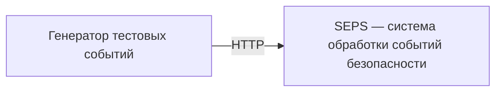
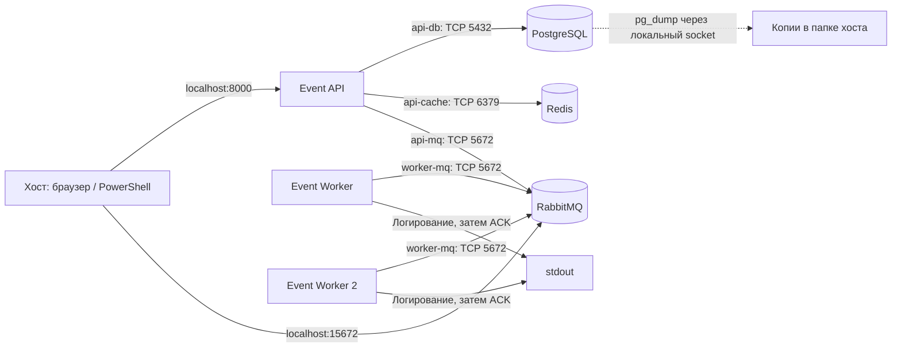

# Security Event Processing System (SEPS)

Учебный проект по курсу **«Безопасность высоконагруженных систем»** (Образовательный центр VK в НИУ ВШЭ).

**Формат:** индивидуальный проект.  
**Цель:** на примере обработки событий безопасности изучить архитектуру микросервисов, интеграцию инфраструктурных компонентов, сетевую сегментацию и базовые практики надёжности. Проект **не является промышленной SIEM**.

## Концепция

SEPS принимает синтетические события безопасности по HTTP API, сохраняет их в PostgreSQL и отправляет уведомления в RabbitMQ. Отдельный Worker получает сообщения и логирует события. Redis ускоряет повторные чтения.

Формат входного события:

```json
{
  "event_type": "failed_login",
  "source_ip": "192.0.2.10",
  "username": "demo"
}
```

Для демонстрации используем синтетические данные. Реальная интеграция с журналами организаций, сложная корреляция событий и пользовательский интерфейс не входят в минимальный объём проекта.

## Компоненты

| Компонент | Назначение |
|---|---|
| Event API (Python / FastAPI) | Запись и чтение событий через HTTP, работа с БД, кэшем и брокером |
| RabbitMQ | Очередь сообщений для асинхронной обработки |
| Event Worker (Python) | Получение сообщений и логирование событий |
| PostgreSQL | Постоянное хранение событий |
| Redis | Кэш событий с TTL |
| Docker Compose | Локальный запуск инфраструктуры |

> Ниже описана реализация ДЗ 3. Сложные правила обработки событий не добавляем.

## Архитектура

### C1 — контекст системы



### C2 — контейнеры и сети (ДЗ 5)



Стрелки сетей обозначают, кто может **инициировать** соединение. Ответы по установленному соединению разрешены. Consumer сам подключается к брокеру, а сообщения получает внутри этого соединения. Общей сети всех сервисов нет. У всех сервисов restart policy; для БД/брокера используются тома. Подробная схема механизмов надёжности — в [документе ДЗ 5](docs/reliability.md).

## Этапы работы

- [x] **ДЗ 1 — Введение в архитектуру:** выбраны предметная область и индивидуальный формат; подготовлена начальная архитектура C1/C2.
- [x] **ДЗ 2 — Монолиты и микросервисы:** минимальный сервис и Docker Compose с PostgreSQL, Redis и RabbitMQ.
- [x] **ДЗ 3 — Переход от монолита к микросервису:** взаимодействие с БД, кэшем и брокером, публикация событий и consumer.
- [x] **ДЗ 4 — Безопасная архитектура:** сетевые зоны, правила межсервисных соединений, демонстрация разрешённых и запрещённых подключений.
- [x] **ДЗ 5 — Построение надёжных систем:** показатели надёжности, отказоустойчивость и резервное копирование.

## Статус

**ДЗ 5 реализовано:** restart всех сервисов, два активных Worker, проверка аварий и backup/restore PostgreSQL. Сохранены четыре сети и локальный firewall с политикой DROP. Сохранены возможности ДЗ 3: `POST /events`, `GET /events/{id}`, PostgreSQL, Redis cache-aside и RabbitMQ consumer. В отличие от первоначальной целевой схемы ДЗ 1, по требованиям ДЗ 3 именно API сохраняет событие и работает с кэшем; Worker только логирует сообщения. `/` и `/health` из ДЗ 2 сохранены.

## Локальный запуск

Нужны Git и Docker с Compose v2.20+. На Windows используем Docker Desktop с WSL 2, в режиме Linux containers. Дождитесь готовности Docker Engine. Python на хосте нужен только для запуска pytest, но не для работы приложения.

```sh
git clone https://github.com/yalkar/security-event-processing-system.git
cd security-event-processing-system
cp .env.example .env
```

В PowerShell: `Copy-Item .env.example .env`. Если проект уже скачан, обновите код; существующий `.env` не перезаписывайте. Новая настройка `CACHE_TTL_SECONDS` необязательна: по умолчанию 60 секунд. Учётные данные ДЗ 2 и существующие тома сохраняются.

`.env.example` содержит только демонстрационные значения. Реальные пароли храните в `.env`, исключённом из Git и Docker build context. API получает доступ к БД и RabbitMQ, Worker — только к RabbitMQ. Redis без аутентификации и без опубликованного порта; сетевые правила разрешают подключение к нему только API.

```sh
docker compose config --quiet
docker compose up --build -d --wait --wait-timeout 180
docker compose ps
docker compose logs --tail=30 event-worker event-worker-standby
```

Ожидаются шесть контейнеров: четыре `healthy`, а `event-worker` и `event-worker-standby` — `Up`. У Worker нет HTTP-сервера и отдельного healthcheck: строка `worker_connected queue=security_events` подтверждает подключение consumer. Сам по себе `Up` подтверждает только работу процесса.

При обновлении работающего стенда с предыдущего задания сначала выполните `docker compose down`, затем команду `up` выше: так все контейнеры получат новую топологию. **Не добавляйте `--volumes`** — события и настройки брокера должны сохраниться. При сборке нужен доступ к Debian/Alpine package repositories для утилит firewall.

Таблица `events` создаётся API через `CREATE TABLE IF NOT EXISTS` при запуске, в том числе в существующем томе ДЗ 2. Удалять тома для обновления не нужно. Для одной фиксированной таблицы пока обходимся без системы миграций.

## HTTP API

| Запрос | Результат |
|---|---|
| `GET /` | `200`, `{"message":"Hello World"}` |
| `GET /health` | `200`, `{"status":"ok"}`; только liveness API |
| `POST /events` | `201`, событие с UUID и временем UTC; заголовок `Location` |
| `GET /events/{id}` | `200`, событие; заголовок `X-Cache` |

Swagger UI: <http://127.0.0.1:8000/docs>. Входное событие содержит три обязательных поля: `event_type` (1–64 символа), корректный IPv4/IPv6 `source_ip`, `username` (1–128 символов). Пустые строки и лишние поля запрещены. В ответ добавляются `id` и `created_at`.

### 1. Запись события — PowerShell

Выполняйте команды по отдельности из папки проекта:

```powershell
$payload = @{
    event_type = "failed_login"
    source_ip = "192.0.2.10"
    username = "demo"
} | ConvertTo-Json

$createdEvent = Invoke-RestMethod -Method Post -Uri "http://127.0.0.1:8000/events" -ContentType "application/json" -Body $payload
$createdEvent
$eventId = $createdEvent.id
```

API последовательно фиксирует транзакцию PostgreSQL, записывает событие в Redis и публикует его JSON в очередь `security_events`. `201` возвращается после подтверждения публикации брокером, но не означает, что Worker уже закончил обработку. При недоступном Redis запись в БД и публикация продолжаются.

Для Bash:

```sh
curl -i -X POST http://127.0.0.1:8000/events -H 'Content-Type: application/json' -d '{"event_type":"failed_login","source_ip":"192.0.2.10","username":"demo"}'
```

### 2. Проверка PostgreSQL

При демонстрационных `POSTGRES_USER=seps` и `POSTGRES_DB=seps`:

```sh
docker compose exec postgres psql -U seps -d seps -c "SELECT id, event_type, source_ip, username, created_at FROM events ORDER BY created_at DESC LIMIT 5;"
```

В таблице должна быть строка с UUID из ответа POST. Если изменяли имя пользователя или БД, подставьте свои значения. Это прямой запрос к PostgreSQL: наличие события в HTTP-ответе или Redis само по себе не доказывает сохранение в БД.

### 3. Чтение, cache hit и cache miss — PowerShell

Сразу после записи, в пределах TTL:

```powershell
$read = Invoke-WebRequest -UseBasicParsing -Uri "http://127.0.0.1:8000/events/$eventId"
$read.Headers["X-Cache"]
$read.Content
```

Ожидается `HIT`, поскольку POST уже заполнил кэш. Если TTL истёк, первый GET вернёт `MISS`, а следующий — `HIT`.

Проверьте значение и оставшееся время жизни ключа:

```powershell
docker compose exec redis redis-cli GET "event:$eventId"
docker compose exec redis redis-cli TTL "event:$eventId"
```

Для воспроизводимого miss удалите **только ключ тестового события**:

```powershell
docker compose exec redis redis-cli DEL "event:$eventId"
$read = Invoke-WebRequest -UseBasicParsing -Uri "http://127.0.0.1:8000/events/$eventId"
$read.Headers["X-Cache"]
$read.Content
docker compose exec redis redis-cli TTL "event:$eventId"
```

Ожидается `MISS`: API прочитал PostgreSQL и снова записал кэш с положительным TTL. Повторный GET в пределах TTL даст `HIT`.

Для Bash скопируйте UUID из POST:

```sh
event_id=ВСТАВЬТЕ_UUID
curl -i "http://127.0.0.1:8000/events/$event_id"
docker compose exec redis redis-cli DEL "event:$event_id"
curl -i "http://127.0.0.1:8000/events/$event_id"
curl -i "http://127.0.0.1:8000/events/$event_id"
```

Заголовки означают: `HIT` — данные Redis, без обращения в БД; `MISS` — ключ отсутствовал или содержал некорректные данные, чтение из БД; `BYPASS` — Redis недоступен, чтение из БД. События неизменяемые: UPDATE/DELETE API пока нет, поэтому после POST достаточно записать кэш по новому UUID. PostgreSQL остаётся источником истины.

### 4. RabbitMQ и Event Worker

```sh
docker compose logs --tail=50 event-worker event-worker-standby
docker compose exec rabbitmq rabbitmqctl list_queues name messages_ready messages_unacknowledged consumers
```

Найдите `received_event` с UUID своего события. Worker логирует полный JSON синтетического события. У очереди `security_events` ожидаются два consumer. При работающем Worker число ожидающих сообщений обычно быстро становится нулём — это нормальный результат потребления.

Чтобы увидеть накопление сообщений:

```sh
docker compose stop event-worker event-worker-standby
```

Создайте ещё одно событие через POST, затем повторите `list_queues`: `messages_ready` должно увеличиться. Верните Worker:

```sh
docker compose start event-worker event-worker-standby
docker compose logs -f event-worker event-worker-standby
```

Должна появиться строка с UUID нового события. `Ctrl+C` завершит просмотр логов, контейнер продолжит работать.

Management UI: <http://127.0.0.1:15672>, логин и пароль — значения `RABBITMQ_DEFAULT_USER` и `RABBITMQ_DEFAULT_PASS` из `.env`. На вкладке Queues можно увидеть `security_events`, consumers и счётчики сообщений.

## Ошибки и повторные подключения

- Некорректный JSON/поля/UUID: `422`. Существующий по формату, но неизвестный UUID: `404`.
- PostgreSQL недоступен: запись или чтение при cache miss вернут `503`. Cache hit может обслуживаться без БД. `/health` не проверяет инфраструктуру и остаётся `200` после успешного старта приложения.
- Redis недоступен: предупреждение в логах, чтение из PostgreSQL с `X-Cache: BYPASS`. Кэш не является условием успешной записи.
- RabbitMQ недоступен или публикация не подтверждена: POST возвращает `503` с `detail.event_id` и `Location`. **Событие уже сохранено в PostgreSQL.** Его можно прочитать по этому ID.

PostgreSQL открывает новое соединение на операцию; Redis использует пул с таймаутами и подключается заново при следующих запросах. API делает до трёх попыток подключения к RabbitMQ на публикацию. Worker повторяет подключение после ошибки с паузой 2 секунды. `depends_on` помогает при первом запуске, но не восстанавливает соединения — это делает код. API ждёт готовности PostgreSQL, Worker — RabbitMQ. `restart: unless-stopped` для всех сервисов помогает при выходе процесса; статус `unhealthy` сам по себе перезапуска не вызывает.

Для ручной проверки остановите `redis`, выполните GET и POST, затем `docker compose start redis`. Повторные чтения снова заполнят кэш. Для проверки PostgreSQL сначала удалите кэш тестового события, остановите `postgres`, получите `503`, запустите БД и повторите GET. Для RabbitMQ остановите брокер, создайте событие, проверьте описанный `503`, запустите брокер и создайте **новое** событие. В логах Worker должны появиться переподключение и получение нового события. Всегда возвращайте остановленные сервисы через `docker compose start <имя>`.

### Границы надёжности учебной реализации

Транзакция PostgreSQL, Redis и RabbitMQ не объединены в одну атомарную операцию. При сбое между сохранением и публикацией строка останется в БД, а сообщение может не попасть в очередь. Автоматической отправки таких строк после восстановления брокера пока нет. При потере подтверждения сообщение, наоборот, уже могло быть принято. Повторный POST создаёт новый UUID и может привести к дубликату события; не повторяйте неудачный POST вслепую. Transactional outbox и идемпотентные запросы — возможное дальнейшее развитие, а не скрытая гарантия этой версии.

Очередь durable, сообщения persistent, публикация использует publisher confirms и `mandatory`. Worker использует `auto_ack=False` и `prefetch_count=1`: ACK отправляется после валидации и логирования. Некорректное сообщение отклоняется с `requeue=False` (без DLQ оно удаляется); при ошибке обработки отправляется NACK с возвратом в очередь. При разрыве соединения неподтверждённое сообщение возвращает брокер. После сбоя между логированием и ACK возможна повторная запись в лог — однократную обработку не обещаем. stdout не является долговременным аудит-хранилищем.

## Тесты

Для pytest нужен Python 3.10+ (в образе приложения — 3.13). Установка dev-зависимостей не нужна работающим контейнерам.

PowerShell, без активации окружения и изменения ExecutionPolicy:

```powershell
py -3 -m venv .venv
.\.venv\Scripts\python.exe -m pip install -r requirements-dev.txt
.\.venv\Scripts\python.exe -m pytest -q
```

Bash:

```sh
python3 -m venv .venv
.venv/bin/python -m pip install -r requirements-dev.txt
.venv/bin/python -m pytest -q
```

Обычный запуск проверяет валидацию и порядок действий POST, чтение HIT/MISS, ошибки БД и брокера, fallback при сбое Redis, повреждённый кэш и ACK/reject/NACK Worker. Инфраструктура подменяется только в этих тестах. Интеграционный тест по умолчанию пропущен.

Для реальной проверки запустите Compose и Worker, затем из папки репозитория:

```powershell
$env:SEPS_INTEGRATION = "1"
.\.venv\Scripts\python.exe -m pytest tests/test_integration.py -v -s
Remove-Item Env:SEPS_INTEGRATION
```

Bash:

```sh
SEPS_INTEGRATION=1 .venv/bin/python -m pytest tests/test_integration.py -v -s
```

Тест создаёт одно синтетическое событие, сверяет строку PostgreSQL с HTTP-ответом, проверяет HIT → удаление ключа → MISS → HIT и TTL, ожидает UUID в логах Worker. Также проверяет `404` и `422`. Запись оставляется в БД для просмотра. Если опубликованный порт API изменён, задайте `SEPS_API_URL`, например `http://127.0.0.1:8001`.

## Инфраструктура и файлы

| Сервис | Доступ с хоста | В сети Compose |
|---|---|---|
| `event-api` | `127.0.0.1:8000` | `event-api:8000` |
| `event-worker` | Нет опубликованных портов | Потребитель RabbitMQ |
| `event-worker-standby` | Нет опубликованных портов | Второй активный consumer RabbitMQ |
| `postgres` | Через `docker compose exec` | `postgres:5432` |
| `redis` | Через `docker compose exec` | `redis:6379` |
| `rabbitmq` | Только management: `127.0.0.1:15672` | AMQP: `rabbitmq:5672` |

Сохраняем базовые образы PostgreSQL 17, Redis 7.4, RabbitMQ 4 management и тома ДЗ 2. Вместо общей сети используются четыре сети, описанные ниже. `docker/Infrastructure.Dockerfile` добавляет к официальным Alpine-образам только утилиты firewall и общий entrypoint; команды запуска и официальные entrypoint сохраняются. Python-зависимости зафиксированы в requirements. Теги образов допускают обновления исправлений; все транзитивные зависимости и digest пока не фиксируем.

API и Worker используют один Dockerfile с разными командами запуска; это независимые процессы в разных контейнерах. После снятия capabilities PID 1 становится непривилегированным Tini, запускающим приложение и позволяющим Docker восстановить контейнер при падении дочернего процесса. Стартовый entrypoint выполняется с root UID для установки локальных правил; до запуска API/Worker переключается на UID 10001 и снимает все capabilities. Официальные entrypoint инфраструктуры переключают UID на postgres/redis/rabbitmq после снятия NET_ADMIN. Для понятности и небольшого учебного трафика БД и публикация открывают соединения на операцию; для высоких нагрузок потребовались бы пулы и дополнительные гарантии.

Тома PostgreSQL и RabbitMQ сохраняются при пересоздании контейнеров. `hostname: rabbitmq` сохраняет имя узла брокера. У Redis отключены RDB/AOF — потерянный кэш восстанавливается из БД.

```text
app/
  main.py              # HTTP endpoints, lifespan и ошибки
  models.py            # Входное событие и ответ с UUID/временем
  database.py          # Таблица, INSERT и SELECT (psycopg)
  cache.py             # Redis, TTL и fallback
  messaging.py         # Подключение и публикация RabbitMQ (pika)
  worker.py            # Consumer, логирование и подтверждения
  tcp_probe.py         # Одноразовая TCP-проверка, различает timeout/refused
  __init__.py
Dockerfile
docker/
  Infrastructure.Dockerfile # Небольшой слой поверх Alpine-образов
  firewall-entrypoint.sh   # Фильтрация внутри контейнера и снятие capabilities
scripts/
  check_networks.py        # Матрица TCP по IP, политики и DROP counters
  backup.py                # Dump, checksum, retention, restore в новую БД
  check_reliability.py     # Аварии, измерения и проверка копии
  install_backup_task.ps1  # Расписание текущего пользователя Windows
docs/
  reliability.md           # MTBF/MTTR/SLI, SLO, RTO/RPO и процедуры
  reliability-results.md   # Измеренные результаты, отдельно от целей
.gitattributes            # LF для shell-скрипта, включая checkout на Windows
docker-compose.yml
requirements.txt
requirements-dev.txt
pytest.ini
tests/
  test_events.py       # Изолированные тесты
  test_integration.py  # Реальная проверка Compose
.env.example
.gitignore
.dockerignore
```

## Сетевая безопасность — ДЗ 4

### Сети и адреса

| Сеть | Участники и IPv4 по умолчанию | Свойства |
|---|---|---|
| `api-db` | API `172.28.10.2`, PostgreSQL `172.28.10.3` | `internal: true`, `/29` |
| `api-cache` | API `172.28.11.2`, Redis `172.28.11.3` | `internal: true`, `/29` |
| `api-mq` | API `172.28.12.2`, RabbitMQ `172.28.12.3` | bridge, `/29`; публикация HTTP/Management |
| `worker-mq` | Worker 1 `172.28.13.2`, Worker 2 `172.28.13.4`, RabbitMQ `172.28.13.3` | `internal: true`, `/29` |

В каждой сети шлюз имеет адрес `.1`. Фиксированные адреса нужны для небольших понятных правил с конкретными source/destination, без разрешения всей подсети. При конфликте с LAN/VPN/другим Docker-проектом задайте свободный двухоктетный `SEPS_NETWORK_PREFIX` в `.env` (например, `172.29`), выполните `down`, затем `up`. Compose и firewall используют одно значение. Старые БД/пароли/тома при этом сохраняются. Префикс выбирает владелец стенда, это доверенная конфигурация.

`api-mq` оставлена обычным bridge для предсказуемой работы опубликованных портов Docker Desktop. Наличие gateway не даёт приложению произвольный исходящий доступ: OUTPUT DROP разрешает только перечисленные ниже соединения. IPv6 не используется для межсервисного обмена и также закрыт локальными ip6tables-правилами.

### Матрица новых соединений

| Источник → назначение | API:8000 | PostgreSQL:5432 | Redis:6379 | RabbitMQ:5672 | RabbitMQ:15672 |
|---|---|---|---|---|---|
| Event API | Локально | ALLOW | ALLOW | ALLOW | DENY |
| Event Worker 1 | DENY | DENY | DENY | ALLOW | DENY |
| Event Worker 2 | DENY | DENY | DENY | ALLOW | DENY |
| PostgreSQL | DENY | Локально | DENY | DENY | DENY |
| Redis | DENY | DENY | Локально | DENY | DENY |
| RabbitMQ | DENY | DENY | DENY | Локально | Локально |
| Хост через опубликованный порт | ALLOW, localhost | Не опубликован | Не опубликован | Не опубликован | ALLOW, localhost |

У Worker нет входного сервисного порта. Остальные новые TCP/UDP-соединения запрещены по умолчанию; ответный трафик разрешён через conntrack `ESTABLISHED,RELATED`. Loopback разрешён для healthcheck, локальных CLI RabbitMQ/PostgreSQL и Docker DNS (`127.0.0.11`). Под «локально» понимается собственное сетевое пространство контейнера, не возможность подключаться к соседу.

### Docker isolation и явный Firewall — разные уровни

**Docker-managed isolation** разделяет bridge-сети и их DNS-области. Worker не состоит в `api-db`/`api-cache`; у PostgreSQL нет общей сети с RabbitMQ. `internal: true` дополнительно ограничивает маршрутизацию за пределы соответствующей сети. Обычные bridge-правила Docker создаёт сам при создании сетей; вручную глобальный firewall Docker-хоста не редактируем.

Одной сегментации недостаточно для полной матрицы: участники общей сети по умолчанию могут обращаться друг к другу на разные порты и в обоих направлениях. Например, Worker и RabbitMQ разделяют сеть, но Worker не должен ходить на Management:15672; PostgreSQL разделяет сеть с API, но не должен сам инициировать HTTP-запросы к API.

**Явный firewall** задаётся `docker/firewall-entrypoint.sh` в network namespace каждого контейнера:

1. Атомарно загружается собственная filter-таблица IPv4 с `INPUT/OUTPUT/FORWARD DROP`. NAT-таблица и Docker DNS не изменяются.
2. Разрешаются loopback, ответный трафик и пять нужных направлений с точными IP/портами (включая Worker 2). Для HTTP API и Management разрешён вход с хоста; участникам подсетей SEPS эти публичные порты закрыты. Адреса gateway доверены как граница Docker-хоста.
3. Для IPv6 установлены DROP-политики с исключением loopback и ответов.
4. Только после успешной установки правил запускается сервис. При ошибке применения firewall entrypoint завершается, не оставляя работающее приложение без правил.

`cap_add: NET_ADMIN` требуется только стартовому скрипту в **собственном** сетевом пространстве. Перед запуском сервиса `setpriv` удаляет её из bounding set и остальных capability sets. У API/Worker UID 10001 и все capabilities сняты. У всех контейнеров отключена NET_RAW и включён `no-new-privileges`. Правила продолжают действовать в ядре без процесса firewall. Дополнительных постоянно работающих firewall-контейнеров нет.

Не используются `privileged`, `network_mode: host`, Docker socket, изменение правил Windows Defender Firewall, `DOCKER-USER` или глобальных iptables/nftables Linux-хоста. Команды `iptables` в проверках ниже выполняются через `docker compose exec` внутри контейнера.

### Воспроизводимая проверка всей матрицы

После запуска стека из папки репозитория:

```powershell
.\.venv\Scripts\python.exe scripts/check_networks.py
```

Либо `python scripts/check_networks.py`, если Python доступен напрямую. На Linux: `.venv/bin/python scripts/check_networks.py`. Дополнительных Python-пакетов для этого скрипта не требуется.

Скрипт читает реальные адреса через `docker inspect`, проверяет состав сетей и политики IPv4/IPv6, отсутствие NET_ADMIN у PID 1, пять разрешённых TCP-направлений и 20 запрещённых подключений к сервисным портам. Затем сверяет рост счётчика OUTPUT DROP у Worker. Запрещённые проверки используют **IP**, а не только отсутствие DNS. Код выхода 0 означает успех; непредвиденный результат приводит к ошибке.

Разрешённые проверки и HTTP-проверка Management сначала подтверждают, что целевые порты действительно слушают. `TIMEOUT` показывает отбрасывание пакетов; `ENETUNREACH`/`EHOSTUNREACH` — отсутствие доступного маршрута. `ECONNREFUSED` означает закрытый порт и **не принимается** как доказательство firewall. Отсутствие DNS (`gaierror`) тоже не считается успехом запрета.

### Четыре обязательные проверки вручную — PowerShell

Получите IP односетевых контейнеров:

```powershell
$pgIp = docker inspect --format '{{range .NetworkSettings.Networks}}{{.IPAddress}}{{end}}' (docker compose ps -q postgres)
$redisIp = docker inspect --format '{{range .NetworkSettings.Networks}}{{.IPAddress}}{{end}}' (docker compose ps -q redis)
```

Разрешены:

```powershell
docker compose exec --user 10001 event-api python -m app.tcp_probe $pgIp 5432 --expect allow
docker compose exec --user 10001 event-worker python -m app.tcp_probe rabbitmq 5672 --expect allow
```

Ожидается `CONNECTED`, `"pass": true`. Теперь тот же **живой** PostgreSQL и Redis из Worker по IP:

```powershell
docker compose exec --user 10001 event-worker python -m app.tcp_probe $pgIp 5432 --expect deny
docker compose exec --user 10001 event-worker python -m app.tcp_probe $redisIp 6379 --expect deny
```

Ожидается `TIMEOUT` либо ошибка маршрутизации и `"pass": true`. Это реальная попытка открыть TCP-сокет, а не DNS-проверка.

### Доказательство явной фильтрации в общей сети

При стандартном префиксе RabbitMQ в `worker-mq` имеет IP `172.28.13.3`. Если меняли префикс, замените его в команде. В полном скрипте выше IP вычисляется автоматически.

```powershell
docker compose exec --user 0 event-worker iptables -nvxL OUTPUT
docker compose exec --user 10001 event-worker python -m app.tcp_probe 172.28.13.3 15672 --expect deny
docker compose exec --user 0 event-worker iptables -nvxL OUTPUT
```

У Worker и RabbitMQ общая сеть и доступный AMQP:5672, Management работает с хоста, но TCP:15672 из Worker завершится `TIMEOUT`. Счётчик пакетов политики OUTPUT DROP увеличится. Это показывает действие **явных правил**, а не только сегментации.

Просмотр всех правил и runtime capabilities:

```powershell
docker compose exec --user 0 event-worker iptables -S
docker compose exec --user 0 event-worker ip6tables -S
docker compose exec event-worker cat /proc/1/status
```

Для остальных сервисов замените имя контейнера. Чтение правил требует NET_ADMIN, поэтому запускается отдельным доверенным процессом `docker exec --user 0` владельца Docker. Процесс приложения PID 1 этой capability не имеет; `check_networks.py` проверяет `CapEff`, `CapPrm`, `CapBnd`. Новый процесс, запущенный администратором через Docker CLI, не является потомком приложения и может иметь capabilities из конфигурации контейнера.

### Проверка сохранения ДЗ 3

Повторите разделы POST, PostgreSQL, HIT/MISS и Worker выше либо запустите:

```powershell
$env:SEPS_INTEGRATION = "1"
.\.venv\Scripts\python.exe -m pytest -q
Remove-Item Env:SEPS_INTEGRATION
```

Интеграционный тест должен пройти с включённым firewall. `/health` продолжает проверять API, а штатные healthcheck инфраструктуры работают через loopback/локальные соединения. Проверки RabbitMQ (`rabbitmqctl`, `rabbitmq-diagnostics`) выполняйте внутри его контейнера.

### Совместимость и ограничения

- Решение рассчитано на Linux containers Docker Desktop под Windows 11/WSL 2. Пользователь вводит команды в PowerShell; Linux iptables выполняется в контейнерах, а не в Windows. Для shell-скрипта задан LF через `.gitattributes`.
- Нужны поддерживаемые ядром netfilter/conntrack и NET_ADMIN при старте. Если настройки Docker запрещают capability, запуск завершится ошибкой. Автоматически переходить к `privileged` или отключать firewall не будем.
- Фиксированные IP упрощают защиту учебного стенда, но не рассчитаны на масштабирование реплик. При смене подсетей пересоздавайте контейнеры. Docker Desktop с включённой Enhanced Container Isolation требует отдельной проверки разрешений.
- Docker/Windows-администратор — доверенная сторона: он может выполнить `docker exec` с root, изменить capability или подключить новый контейнер к сети. Эта защита ограничивает процессы сервисов, но не владельца Docker daemon.
- Хостовые gateway и loopback/Docker DNS — необходимые исключения. Это не L7 firewall и не фильтрация DNS-запросов. HTTP-аутентификацию, TLS, защиту от DoS и sandbox от уязвимостей ядра эта работа не добавляет.
- TCP-тесты покрывают заданные слушающие порты и обе стороны важных связей; они не сканируют все 65535 портов. Закрытие прочих новых соединений следует из DROP-политик, состав которых проверяется отдельно.
- Сначала выполните локальные проверки на своей версии Docker Desktop: облачная Linux-проверка не заменяет проверку конкретной Windows-машины.

## Надёжность и резервные копии — ДЗ 5

Полная методика, сценарии и ограничения: [docs/reliability.md](docs/reliability.md). Фактические результаты: [docs/reliability-results.md](docs/reliability-results.md).

В семинаре указан CLI, в лекции — SLI. Используем SLI как рабочую трактовку, **без утверждения о подтверждённом исправлении преподавателя**.

| Показатель | Учебная цель | Что измерено |
|---|---|---|
| MTBF | ≥8 ч исправной работы отдельного процесса | Длительного наблюдения нет; не оцениваем по инъекциям отказов |
| MTTR / TTR | Восстановление API/Worker ≤30 с | Время конкретных аварийных экспериментов, не долгосрочный MTTR |
| SLI доступности / SLO | ≥99% валидных HTTP-запросов за 10 минут | Выборка вокруг управляемой аварии; не подтверждает долгосрочный SLO |
| SLI задержки | p95 GET ≤500 мс при доступных зависимостях | Задержки проб в отчёте эксперимента |
| RTO | API/Worker ≤30 с; БД/брокер ≤60 с; малый restore ≤120 с | Критерии и измерения в документе результатов |
| RPO | 0 при проверенном рестарте с целым томом; цель ≤24 ч для ежедневных копий | Проверены конкретные строки и persistent-сообщение; потеря хоста не покрыта |

Все сервисы имеют `restart: unless-stopped`. Это автоматическое восстановление, а не HA всей системы. Два Worker резервируют обработку сообщений; API, PostgreSQL, RabbitMQ и Docker-хост остаются едиными точками отказа. Второй Worker добавляет только одно разрешение в существующей сети: `.13.4` → RabbitMQ `.13.3`:5672. Остальные запреты ДЗ 4 сохраняются.

Создать и проверить копию из PowerShell (нужен Python):

```powershell
$copy = (py -3 -m scripts.backup create --directory backups --keep 7) | ConvertFrom-Json
py -3 -m scripts.backup verify $copy.archive
$testDb = "seps_restore_" + (Get-Date -Format "yyyyMMddHHmmss")
py -3 -m scripts.backup restore $copy.archive --database $testDb
```

Архивы и SHA-256-манифесты хранятся **в папке хоста, отдельно от рабочего Docker Volume**, и исключены из Git. Сохраняются последние семь успешных копий. Восстановление допускается только в новую `seps_restore_*` БД, без перезаписи production. Расписание ежедневно и проверка Task Scheduler описаны в документе; Docker Desktop должен работать. Копия на том же физическом хосте не защищает от потери этого хоста.

Запустить контролируемые аварии с измерениями:

```powershell
py -3 -m scripts.check_reliability --report reports/reliability.json
py -3 scripts/check_networks.py
```

Скрипт аварий намеренно прерывает процессы/зависимости, добавляет синтетические события и сохраняет отдельную тестовую БД. Запускайте его на учебном стенде отдельно от других тестов. Рабочие данные не удаляются; в `finally` возвращаются запущенные сервисы. Программа проверяет crash API/Worker, работу второго consumer, Redis BYPASS→HIT, восстановление PostgreSQL, persistent-сообщение после рестарта RabbitMQ и содержимое восстановленной копии.

## Остановка и диагностика

```sh
docker compose logs --tail=100
docker compose logs -f event-api event-worker event-worker-standby
docker compose down
```

`down` сохраняет именованные тома. Полный сброс **удаляет данные PostgreSQL и RabbitMQ**:

```sh
docker compose down --volumes
```

Пароли начальной настройки БД/брокера применяются к пустому хранилищу. Изменение `.env` не меняет уже сохранённые пароли. Используйте прежние значения либо отдельно изменяйте пользователей. Не удаляйте тома, если нужны данные.

Если порты `8000` или `15672` заняты, освободите их или измените левую часть `ports` (например, `127.0.0.1:8001:8000`) и адреса проверок. При сбое смотрите `docker compose ps` и `docker compose logs <имя-сервиса>`.

## Принципы разработки

1. Выполняем требования текущего ДЗ без полноценной SIEM и лишних сервисов.
2. Каждое решение должно быть объяснимым на защите; ограничения надёжности указываем явно.
3. Используем синтетические события, не добавляем реальные секреты и чувствительные данные в Git или логи.
