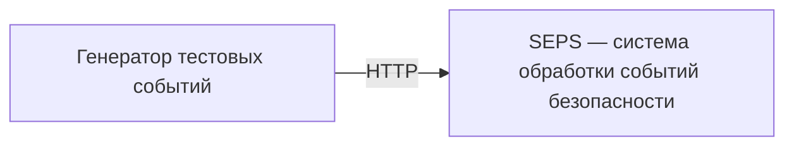
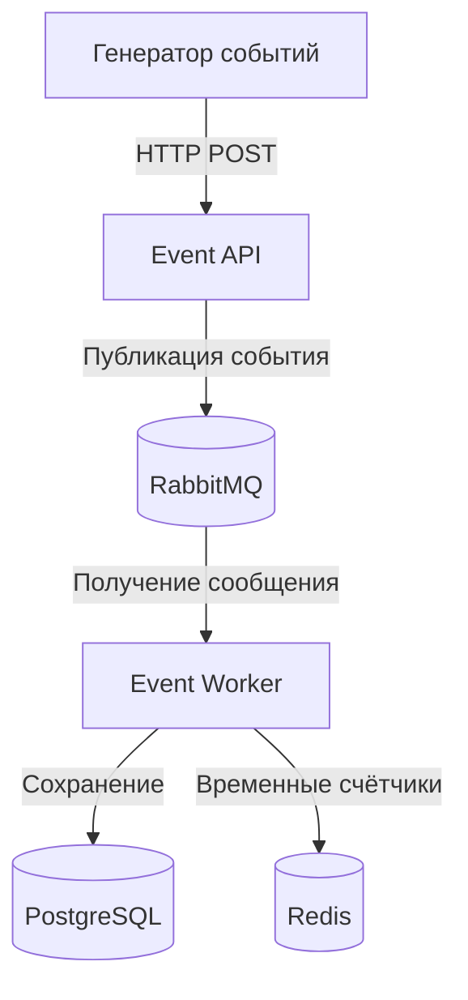

# Security Event Processing System (SEPS)

Учебный проект по курсу **«Безопасность высоконагруженных систем»** (Образовательный центр VK в НИУ ВШЭ).

**Формат:** индивидуальный проект.  
**Цель:** на примере обработки событий безопасности изучить архитектуру микросервисов, интеграцию инфраструктурных компонентов, сетевую сегментацию и базовые практики надёжности. Проект **не является промышленной SIEM**.

## Концепция

SEPS принимает тестовые события безопасности по HTTP API, передаёт их на асинхронную обработку и сохраняет результаты.

Пример события (проектный формат, будет уточнён при реализации):

```json
{
  "event_type": "failed_login",
  "source_ip": "192.0.2.10",
  "username": "demo"
}
```

Для демонстрации используем синтетические данные. Реальная интеграция с журналами организаций, сложная корреляция событий и пользовательский интерфейс не входят в минимальный объём проекта.

## Планируемые компоненты

| Компонент | Назначение |
|---|---|
| Event API (Python / FastAPI) | Приём событий через HTTP |
| RabbitMQ | Очередь сообщений для асинхронной обработки |
| Event Worker (Python) | Получение и обработка сообщений |
| PostgreSQL | Постоянное хранение событий |
| Redis | Кэш и временные счётчики |
| Docker Compose | Локальный запуск инфраструктуры |

> Это целевая архитектура, а не описание уже реализованной системы.

## Архитектура

### C1 — контекст системы



### C2 — контейнеры (целевая схема)



Сетевую сегментацию, правила доступа, резервное копирование и механизмы восстановления добавим в следующих заданиях.

## Этапы работы

- [x] **ДЗ 1 — Введение в архитектуру:** выбраны предметная область и индивидуальный формат; подготовлена начальная архитектура C1/C2.
- [ ] **ДЗ 2 — Монолиты и микросервисы:** минимальный сервис и Docker Compose с PostgreSQL, Redis и RabbitMQ.
- [ ] **ДЗ 3 — Переход от монолита к микросервису:** взаимодействие с БД, кэшем и брокером, публикация событий и consumer.
- [ ] **ДЗ 4 — Безопасная архитектура:** сетевые зоны, правила межсервисных соединений, демонстрация разрешённых и запрещённых подключений.
- [ ] **ДЗ 5 — Построение надёжных систем:** показатели надёжности, отказоустойчивость и резервное копирование.

## Статус

**ДЗ 1 — проектирование.** Работающий код появится на следующих этапах. Команды запуска будут добавлены вместе с реализацией.

## Принципы разработки

1. Сначала выполняем минимальные требования конкретного ДЗ, затем расширяем систему.
2. Каждое архитектурное решение должно быть объяснимым на защите.
3. В репозиторий не добавляем реальные секреты, ключи доступа и чувствительные события.
