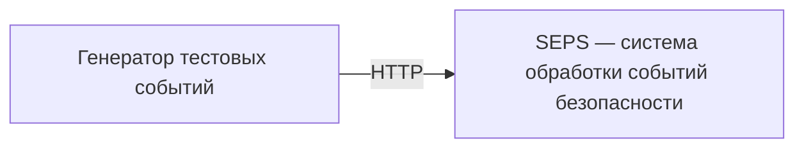
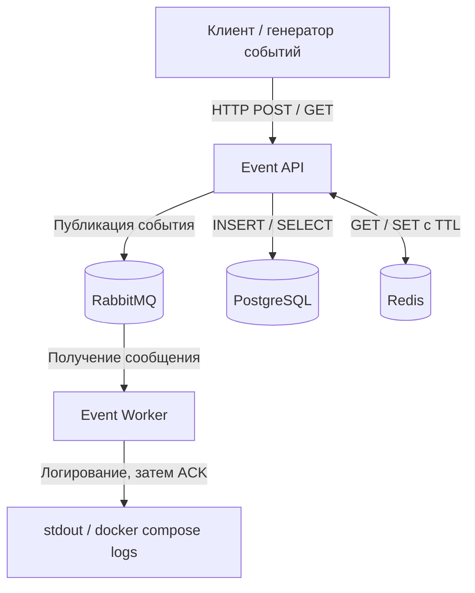

# Security Event Processing System (SEPS)

Учебный проект по курсу **«Безопасность высоконагруженных систем»** (Образовательный центр VK в НИУ ВШЭ).

**Формат:** индивидуальный проект.  
**Цель:** на примере обработки событий безопасности изучить архитектуру микросервисов, интеграцию инфраструктурных компонентов, сетевую сегментацию и базовые практики надёжности. Проект **не является промышленной SIEM**.

## Концепция

SEPS принимает синтетические события безопасности по HTTP API, сохраняет их в PostgreSQL и отправляет уведомления в RabbitMQ. Отдельный Worker получает сообщения и логирует события. Redis ускоряет повторные чтения.

Формат входного события:

```json
{
  "event_type": "failed_login",
  "source_ip": "192.0.2.10",
  "username": "demo"
}
```

Для демонстрации используем синтетические данные. Реальная интеграция с журналами организаций, сложная корреляция событий и пользовательский интерфейс не входят в минимальный объём проекта.

## Компоненты

| Компонент | Назначение |
|---|---|
| Event API (Python / FastAPI) | Запись и чтение событий через HTTP, работа с БД, кэшем и брокером |
| RabbitMQ | Очередь сообщений для асинхронной обработки |
| Event Worker (Python) | Получение сообщений и логирование событий |
| PostgreSQL | Постоянное хранение событий |
| Redis | Кэш событий с TTL |
| Docker Compose | Локальный запуск инфраструктуры |

> Ниже описана реализация ДЗ 3. Сложные правила обработки событий не добавляем.

## Архитектура

### C1 — контекст системы



### C2 — контейнеры (ДЗ 3)



Сетевую сегментацию, правила доступа, резервное копирование и механизмы восстановления добавим в следующих заданиях.

## Этапы работы

- [x] **ДЗ 1 — Введение в архитектуру:** выбраны предметная область и индивидуальный формат; подготовлена начальная архитектура C1/C2.
- [x] **ДЗ 2 — Монолиты и микросервисы:** минимальный сервис и Docker Compose с PostgreSQL, Redis и RabbitMQ.
- [x] **ДЗ 3 — Переход от монолита к микросервису:** взаимодействие с БД, кэшем и брокером, публикация событий и consumer.
- [ ] **ДЗ 4 — Безопасная архитектура:** сетевые зоны, правила межсервисных соединений, демонстрация разрешённых и запрещённых подключений.
- [ ] **ДЗ 5 — Построение надёжных систем:** показатели надёжности, отказоустойчивость и резервное копирование.

## Статус

**ДЗ 3 реализовано:** `POST /events`, `GET /events/{id}`, PostgreSQL, Redis cache-aside и RabbitMQ consumer. В отличие от первоначальной целевой схемы ДЗ 1, по требованиям ДЗ 3 именно API сохраняет событие и работает с кэшем; Worker только логирует сообщения. `/` и `/health` из ДЗ 2 сохранены.

## Локальный запуск

Нужны Git и Docker с Compose v2.20+. На Windows используем Docker Desktop с WSL 2, в режиме Linux containers. Дождитесь готовности Docker Engine. Python на хосте нужен только для запуска pytest, но не для работы приложения.

```sh
git clone https://github.com/yalkar/security-event-processing-system.git
cd security-event-processing-system
cp .env.example .env
```

В PowerShell: `Copy-Item .env.example .env`. Если проект уже скачан, обновите код; существующий `.env` не перезаписывайте. Новая настройка `CACHE_TTL_SECONDS` необязательна: по умолчанию 60 секунд. Учётные данные ДЗ 2 и существующие тома сохраняются.

`.env.example` содержит только демонстрационные значения. Реальные пароли храните в `.env`, исключённом из Git и Docker build context. API получает доступ к БД и RabbitMQ, Worker — только к RabbitMQ. Redis пока без аутентификации и без опубликованного порта; разграничение доступа — ДЗ 4.

```sh
docker compose config --quiet
docker compose up --build -d --wait --wait-timeout 180
docker compose ps
docker compose logs --tail=30 event-worker
```

Ожидаются четыре контейнера `healthy` и `event-worker` со статусом `Up`. У Worker нет HTTP-сервера и отдельного healthcheck: строка `worker_connected queue=security_events` подтверждает подключение consumer. Сам по себе `Up` подтверждает только работу процесса.

Таблица `events` создаётся API через `CREATE TABLE IF NOT EXISTS` при запуске, в том числе в существующем томе ДЗ 2. Удалять тома для обновления не нужно. Для одной фиксированной таблицы пока обходимся без системы миграций.

## HTTP API

| Запрос | Результат |
|---|---|
| `GET /` | `200`, `{"message":"Hello World"}` |
| `GET /health` | `200`, `{"status":"ok"}`; только liveness API |
| `POST /events` | `201`, событие с UUID и временем UTC; заголовок `Location` |
| `GET /events/{id}` | `200`, событие; заголовок `X-Cache` |

Swagger UI: <http://127.0.0.1:8000/docs>. Входное событие содержит три обязательных поля: `event_type` (1–64 символа), корректный IPv4/IPv6 `source_ip`, `username` (1–128 символов). Пустые строки и лишние поля запрещены. В ответ добавляются `id` и `created_at`.

### 1. Запись события — PowerShell

Выполняйте команды по отдельности из папки проекта:

```powershell
$payload = @{
    event_type = "failed_login"
    source_ip = "192.0.2.10"
    username = "demo"
} | ConvertTo-Json

$createdEvent = Invoke-RestMethod -Method Post -Uri "http://127.0.0.1:8000/events" -ContentType "application/json" -Body $payload
$createdEvent
$eventId = $createdEvent.id
```

API последовательно фиксирует транзакцию PostgreSQL, записывает событие в Redis и публикует его JSON в очередь `security_events`. `201` возвращается после подтверждения публикации брокером, но не означает, что Worker уже закончил обработку. При недоступном Redis запись в БД и публикация продолжаются.

Для Bash:

```sh
curl -i -X POST http://127.0.0.1:8000/events -H 'Content-Type: application/json' -d '{"event_type":"failed_login","source_ip":"192.0.2.10","username":"demo"}'
```

### 2. Проверка PostgreSQL

При демонстрационных `POSTGRES_USER=seps` и `POSTGRES_DB=seps`:

```sh
docker compose exec postgres psql -U seps -d seps -c "SELECT id, event_type, source_ip, username, created_at FROM events ORDER BY created_at DESC LIMIT 5;"
```

В таблице должна быть строка с UUID из ответа POST. Если изменяли имя пользователя или БД, подставьте свои значения. Это прямой запрос к PostgreSQL: наличие события в HTTP-ответе или Redis само по себе не доказывает сохранение в БД.

### 3. Чтение, cache hit и cache miss — PowerShell

Сразу после записи, в пределах TTL:

```powershell
$read = Invoke-WebRequest -UseBasicParsing -Uri "http://127.0.0.1:8000/events/$eventId"
$read.Headers["X-Cache"]
$read.Content
```

Ожидается `HIT`, поскольку POST уже заполнил кэш. Если TTL истёк, первый GET вернёт `MISS`, а следующий — `HIT`.

Проверьте значение и оставшееся время жизни ключа:

```powershell
docker compose exec redis redis-cli GET "event:$eventId"
docker compose exec redis redis-cli TTL "event:$eventId"
```

Для воспроизводимого miss удалите **только ключ тестового события**:

```powershell
docker compose exec redis redis-cli DEL "event:$eventId"
$read = Invoke-WebRequest -UseBasicParsing -Uri "http://127.0.0.1:8000/events/$eventId"
$read.Headers["X-Cache"]
$read.Content
docker compose exec redis redis-cli TTL "event:$eventId"
```

Ожидается `MISS`: API прочитал PostgreSQL и снова записал кэш с положительным TTL. Повторный GET в пределах TTL даст `HIT`.

Для Bash скопируйте UUID из POST:

```sh
event_id=ВСТАВЬТЕ_UUID
curl -i "http://127.0.0.1:8000/events/$event_id"
docker compose exec redis redis-cli DEL "event:$event_id"
curl -i "http://127.0.0.1:8000/events/$event_id"
curl -i "http://127.0.0.1:8000/events/$event_id"
```

Заголовки означают: `HIT` — данные Redis, без обращения в БД; `MISS` — ключ отсутствовал или содержал некорректные данные, чтение из БД; `BYPASS` — Redis недоступен, чтение из БД. События неизменяемые: UPDATE/DELETE API пока нет, поэтому после POST достаточно записать кэш по новому UUID. PostgreSQL остаётся источником истины.

### 4. RabbitMQ и Event Worker

```sh
docker compose logs --tail=50 event-worker
docker compose exec rabbitmq rabbitmqctl list_queues name messages_ready messages_unacknowledged consumers
```

Найдите `received_event` с UUID своего события. Worker логирует полный JSON синтетического события. У очереди `security_events` ожидается один consumer. При работающем Worker число ожидающих сообщений обычно быстро становится нулём — это нормальный результат потребления.

Чтобы увидеть накопление сообщений:

```sh
docker compose stop event-worker
```

Создайте ещё одно событие через POST, затем повторите `list_queues`: `messages_ready` должно увеличиться. Верните Worker:

```sh
docker compose start event-worker
docker compose logs -f event-worker
```

Должна появиться строка с UUID нового события. `Ctrl+C` завершит просмотр логов, контейнер продолжит работать.

Management UI: <http://127.0.0.1:15672>, логин и пароль — значения `RABBITMQ_DEFAULT_USER` и `RABBITMQ_DEFAULT_PASS` из `.env`. На вкладке Queues можно увидеть `security_events`, consumers и счётчики сообщений.

## Ошибки и повторные подключения

- Некорректный JSON/поля/UUID: `422`. Существующий по формату, но неизвестный UUID: `404`.
- PostgreSQL недоступен: запись или чтение при cache miss вернут `503`. Cache hit может обслуживаться без БД. `/health` не проверяет инфраструктуру и остаётся `200` после успешного старта приложения.
- Redis недоступен: предупреждение в логах, чтение из PostgreSQL с `X-Cache: BYPASS`. Кэш не является условием успешной записи.
- RabbitMQ недоступен или публикация не подтверждена: POST возвращает `503` с `detail.event_id` и `Location`. **Событие уже сохранено в PostgreSQL.** Его можно прочитать по этому ID.

PostgreSQL открывает новое соединение на операцию; Redis использует пул с таймаутами и подключается заново при следующих запросах. API делает до трёх попыток подключения к RabbitMQ на публикацию. Worker повторяет подключение после ошибки с паузой 2 секунды. `depends_on` помогает при первом запуске, но не восстанавливает соединения — это делает код. API ждёт готовности PostgreSQL, Worker — RabbitMQ. `restart: unless-stopped` для API/Worker помогает при выходе процесса; статус `unhealthy` сам по себе перезапуска не вызывает.

Для ручной проверки остановите `redis`, выполните GET и POST, затем `docker compose start redis`. Повторные чтения снова заполнят кэш. Для проверки PostgreSQL сначала удалите кэш тестового события, остановите `postgres`, получите `503`, запустите БД и повторите GET. Для RabbitMQ остановите брокер, создайте событие, проверьте описанный `503`, запустите брокер и создайте **новое** событие. В логах Worker должны появиться переподключение и получение нового события. Всегда возвращайте остановленные сервисы через `docker compose start <имя>`.

### Границы надёжности учебной реализации

Транзакция PostgreSQL, Redis и RabbitMQ не объединены в одну атомарную операцию. При сбое между сохранением и публикацией строка останется в БД, а сообщение может не попасть в очередь. Автоматической отправки таких строк после восстановления брокера пока нет. При потере подтверждения сообщение, наоборот, уже могло быть принято. Повторный POST создаёт новый UUID и может привести к дубликату события; не повторяйте неудачный POST вслепую. Transactional outbox и идемпотентные запросы — возможное дальнейшее развитие, а не скрытая гарантия этой версии.

Очередь durable, сообщения persistent, публикация использует publisher confirms и `mandatory`. Worker использует `auto_ack=False` и `prefetch_count=1`: ACK отправляется после валидации и логирования. Некорректное сообщение отклоняется с `requeue=False` (без DLQ оно удаляется); при ошибке обработки отправляется NACK с возвратом в очередь. При разрыве соединения неподтверждённое сообщение возвращает брокер. После сбоя между логированием и ACK возможна повторная запись в лог — однократную обработку не обещаем. stdout не является долговременным аудит-хранилищем.

## Тесты

Для pytest нужен Python 3.10+ (в образе приложения — 3.13). Установка dev-зависимостей не нужна работающим контейнерам.

PowerShell, без активации окружения и изменения ExecutionPolicy:

```powershell
py -3 -m venv .venv
.\.venv\Scripts\python.exe -m pip install -r requirements-dev.txt
.\.venv\Scripts\python.exe -m pytest -q
```

Bash:

```sh
python3 -m venv .venv
.venv/bin/python -m pip install -r requirements-dev.txt
.venv/bin/python -m pytest -q
```

Обычный запуск проверяет валидацию и порядок действий POST, чтение HIT/MISS, ошибки БД и брокера, fallback при сбое Redis, повреждённый кэш и ACK/reject/NACK Worker. Инфраструктура подменяется только в этих тестах. Интеграционный тест по умолчанию пропущен.

Для реальной проверки запустите Compose и Worker, затем из папки репозитория:

```powershell
$env:SEPS_INTEGRATION = "1"
.\.venv\Scripts\python.exe -m pytest tests/test_integration.py -v -s
Remove-Item Env:SEPS_INTEGRATION
```

Bash:

```sh
SEPS_INTEGRATION=1 .venv/bin/python -m pytest tests/test_integration.py -v -s
```

Тест создаёт одно синтетическое событие, сверяет строку PostgreSQL с HTTP-ответом, проверяет HIT → удаление ключа → MISS → HIT и TTL, ожидает UUID в логах Worker. Также проверяет `404` и `422`. Запись оставляется в БД для просмотра. Если опубликованный порт API изменён, задайте `SEPS_API_URL`, например `http://127.0.0.1:8001`.

## Инфраструктура и файлы

| Сервис | Доступ с хоста | В сети Compose |
|---|---|---|
| `event-api` | `127.0.0.1:8000` | `event-api:8000` |
| `event-worker` | Нет опубликованных портов | Потребитель RabbitMQ |
| `postgres` | Через `docker compose exec` | `postgres:5432` |
| `redis` | Через `docker compose exec` | `redis:6379` |
| `rabbitmq` | Только management: `127.0.0.1:15672` | AMQP: `rabbitmq:5672` |

Сохраняем образы PostgreSQL 17, Redis 7.4, RabbitMQ 4 management и одну сеть Compose из ДЗ 2. Python-зависимости зафиксированы в requirements. Теги образов допускают обновления исправлений; все транзитивные зависимости и digest пока не фиксируем.

API и Worker используют один Dockerfile с разными командами запуска; это два независимых процесса в разных контейнерах. Образ работает от непривилегированного пользователя. Для понятности и небольшого учебного трафика БД и публикация открывают соединения на операцию; для высоких нагрузок потребовались бы пулы и дополнительные гарантии.

Тома PostgreSQL и RabbitMQ сохраняются при пересоздании контейнеров. `hostname: rabbitmq` сохраняет имя узла брокера. У Redis отключены RDB/AOF — потерянный кэш восстанавливается из БД.

```text
app/
  main.py              # HTTP endpoints, lifespan и ошибки
  models.py            # Входное событие и ответ с UUID/временем
  database.py          # Таблица, INSERT и SELECT (psycopg)
  cache.py             # Redis, TTL и fallback
  messaging.py         # Подключение и публикация RabbitMQ (pika)
  worker.py            # Consumer, логирование и подтверждения
  __init__.py
Dockerfile
docker-compose.yml
requirements.txt
requirements-dev.txt
pytest.ini
tests/
  test_events.py       # Изолированные тесты
  test_integration.py  # Реальная проверка Compose
.env.example
.gitignore
.dockerignore
```

## Остановка и диагностика

```sh
docker compose logs --tail=100
docker compose logs -f event-api event-worker
docker compose down
```

`down` сохраняет именованные тома. Полный сброс **удаляет данные PostgreSQL и RabbitMQ**:

```sh
docker compose down --volumes
```

Пароли начальной настройки БД/брокера применяются к пустому хранилищу. Изменение `.env` не меняет уже сохранённые пароли. Используйте прежние значения либо отдельно изменяйте пользователей. Не удаляйте тома, если нужны данные.

Если порты `8000` или `15672` заняты, освободите их или измените левую часть `ports` (например, `127.0.0.1:8001:8000`) и адреса проверок. При сбое смотрите `docker compose ps` и `docker compose logs <имя-сервиса>`.

## Принципы разработки

1. Выполняем требования текущего ДЗ без полноценной SIEM и лишних сервисов.
2. Каждое решение должно быть объяснимым на защите; ограничения надёжности указываем явно.
3. Используем синтетические события, не добавляем реальные секреты и чувствительные данные в Git или логи.
