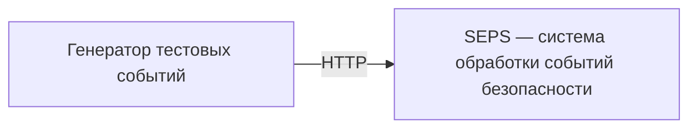
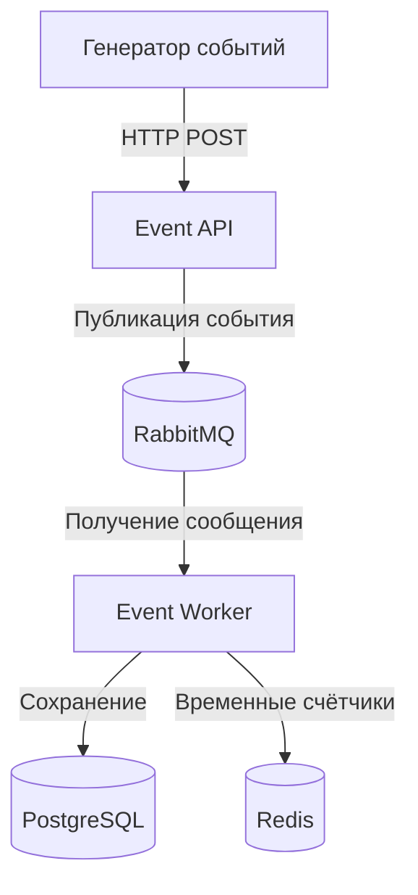

# Security Event Processing System (SEPS)

Учебный проект по курсу **«Безопасность высоконагруженных систем»** (Образовательный центр VK в НИУ ВШЭ).

**Формат:** индивидуальный проект.  
**Цель:** на примере обработки событий безопасности изучить архитектуру микросервисов, интеграцию инфраструктурных компонентов, сетевую сегментацию и базовые практики надёжности. Проект **не является промышленной SIEM**.

## Концепция

SEPS принимает тестовые события безопасности по HTTP API, передаёт их на асинхронную обработку и сохраняет результаты.

Пример события (проектный формат, будет уточнён при реализации):

```json
{
  "event_type": "failed_login",
  "source_ip": "192.0.2.10",
  "username": "demo"
}
```

Для демонстрации используем синтетические данные. Реальная интеграция с журналами организаций, сложная корреляция событий и пользовательский интерфейс не входят в минимальный объём проекта.

## Планируемые компоненты

| Компонент | Назначение |
|---|---|
| Event API (Python / FastAPI) | Приём событий через HTTP |
| RabbitMQ | Очередь сообщений для асинхронной обработки |
| Event Worker (Python) | Получение и обработка сообщений |
| PostgreSQL | Постоянное хранение событий |
| Redis | Кэш и временные счётчики |
| Docker Compose | Локальный запуск инфраструктуры |

> Это целевая архитектура, а не описание уже реализованной системы.

## Архитектура

### C1 — контекст системы



### C2 — контейнеры (целевая схема)



Сетевую сегментацию, правила доступа, резервное копирование и механизмы восстановления добавим в следующих заданиях.

## Этапы работы

- [x] **ДЗ 1 — Введение в архитектуру:** выбраны предметная область и индивидуальный формат; подготовлена начальная архитектура C1/C2.
- [x] **ДЗ 2 — Монолиты и микросервисы:** минимальный сервис и Docker Compose с PostgreSQL, Redis и RabbitMQ.
- [ ] **ДЗ 3 — Переход от монолита к микросервису:** взаимодействие с БД, кэшем и брокером, публикация событий и consumer.
- [ ] **ДЗ 4 — Безопасная архитектура:** сетевые зоны, правила межсервисных соединений, демонстрация разрешённых и запрещённых подключений.
- [ ] **ДЗ 5 — Построение надёжных систем:** показатели надёжности, отказоустойчивость и резервное копирование.

## Статус

**ДЗ 2 — минимальная инфраструктура.** В Compose запускаются четыре отдельных контейнера: заготовка Event API, PostgreSQL, Redis и RabbitMQ. API возвращает Hello World и отвечает на проверку здоровья. Обработка событий, Event Worker и подключения приложения к инфраструктуре появятся в ДЗ 3; C1/C2 выше по-прежнему описывают целевую архитектуру.

## Локальный запуск

Нужны Git и Docker с Compose v2.20+ (например, Docker Desktop или Docker Engine с Compose plugin). Docker daemon должен быть запущен. Устанавливать Python, PostgreSQL, Redis или RabbitMQ на хост не требуется.

```sh
git clone https://github.com/yalkar/security-event-processing-system.git
cd security-event-processing-system
cp .env.example .env
```

В PowerShell вместо `cp` можно использовать `Copy-Item .env.example .env`.

`.env.example` содержит демонстрационные учётные данные для локального стенда. При необходимости измените их в `.env` перед первым запуском. `.env` исключён из Git и контекста сборки; это удобство локальной настройки, а не промышленное хранилище секретов. Compose передаёт учётные данные только PostgreSQL и RabbitMQ, приложению они пока не нужны.

```sh
docker compose config --quiet
docker compose up --build -d --wait --wait-timeout 180
docker compose ps
```

Первая команда проверяет конфигурацию, вторая собирает образ API и запускает стек. `--wait` ожидает успешных healthcheck всех четырёх сервисов; при превышении времени ожидания команда завершится с ошибкой. В `ps` все четыре контейнера должны иметь статус `healthy`.

### Проверка компонентов

**Event API:**

```sh
curl -fsS http://127.0.0.1:8000/
# {"message":"Hello World"}

curl -fsS http://127.0.0.1:8000/health
# {"status":"ok"}
```

В PowerShell можно вызвать `curl.exe` или открыть адреса в браузере. Swagger UI доступен на <http://127.0.0.1:8000/docs>. `/health` проверяет только HTTP-сервис: успешный ответ не означает доступность БД, кэша или брокера.

**PostgreSQL:** проверяем готовность сервера, затем реальное SQL-подключение с паролем из окружения контейнера:

```sh
docker compose exec postgres sh -c 'pg_isready -U "$POSTGRES_USER" -d "$POSTGRES_DB"'
docker compose exec postgres sh -c 'PGPASSWORD="$POSTGRES_PASSWORD" psql -h 127.0.0.1 -U "$POSTGRES_USER" -d "$POSTGRES_DB" -c "SELECT 1;"'
```

Ожидаются `accepting connections` и результат SQL-запроса `1`. Сам по себе `pg_isready` не проверяет корректность пароля.

**Redis:**

```sh
docker compose exec redis redis-cli ping
# PONG
```

**RabbitMQ:**

```sh
docker compose exec rabbitmq rabbitmq-diagnostics -q ping
docker compose exec rabbitmq rabbitmq-diagnostics -q check_running
docker compose exec rabbitmq rabbitmq-diagnostics -q check_port_connectivity
```

Команды должны завершиться с кодом `0`: они проверяют доступность узла, работу приложения брокера и его TCP listeners. Веб-интерфейс доступен на <http://127.0.0.1:15672>; логин и пароль берутся из `RABBITMQ_DEFAULT_USER` и `RABBITMQ_DEFAULT_PASS` в `.env`. Вход в интерфейс дополнительно проверяет эти учётные данные. Сообщения и очереди на этом этапе не создаём.

### Остановка и диагностика

```sh
docker compose logs --tail=100
docker compose logs -f event-api
docker compose down
```

`down` удаляет контейнеры и сеть, сохраняя именованные тома. Повторный запуск выполняется той же командой `up`.

Для полного сброса **с удалением данных PostgreSQL и RabbitMQ**:

```sh
docker compose down --volumes
```

Переменные начальной настройки PostgreSQL и пользователя RabbitMQ применяются при инициализации пустого хранилища. Редактирование `.env` не меняет уже сохранённые пароли. Для учебного стенда можно удалить тома и запустить стек заново, если данные больше не нужны.

Если контейнер не стал `healthy`, проверьте `docker compose ps` и `docker compose logs <имя-сервиса>`. Если порты `8000` или `15672` заняты, освободите их или измените левую часть соответствующей привязки в `ports` (например, `127.0.0.1:8001:8000`), затем используйте новый порт в адресе проверки.

## Решения для ДЗ 2

| Сервис | Роль в проекте | Доступ с хоста | Адрес внутри сети Compose |
|---|---|---|---|
| `event-api` | Заготовка будущего приёмника событий; сейчас Hello World | `127.0.0.1:8000` | `event-api:8000` |
| `postgres` | Будущее постоянное хранилище событий | Порт не опубликован; проверяем через `exec` | `postgres:5432` |
| `redis` | Будущий кэш и временные счётчики | Порт не опубликован; проверяем через `exec` | `redis:6379` |
| `rabbitmq` | Будущий брокер для связи API и Worker | Только веб-интерфейс: `127.0.0.1:15672` | AMQP: `rabbitmq:5672` |

- **Один небольшой сервис.** `app/main.py` содержит два HTTP-маршрута. Используем FastAPI и Uvicorn без клиентов БД, кэша и очередей. Worker пока не создаём.
- **Dockerfile.** Базовый образ Python 3.13 slim; версии FastAPI и Uvicorn зафиксированы в `requirements.txt`. Зависимости копируются до кода, чтобы Docker мог использовать кэш установки при изменениях приложения. API работает от непривилегированного пользователя. `0.0.0.0` нужен для доступа к процессу через сеть контейнера; `127.0.0.1` в `ports` ограничивает опубликованный порт на хосте.
- **Версии образов.** Выбраны PostgreSQL 17, Redis 7.4 и RabbitMQ 4 с management plugin, без тега `latest`. Теги допускают обновления исправлений; для побитово повторяемых сборок потребовалась бы фиксация digest образов и всех транзитивных Python-зависимостей.
- **Сеть.** Compose автоматически создаёт одну общую сеть и DNS по именам сервисов. `localhost` внутри контейнера обозначает его самого. PostgreSQL, Redis и AMQP не публикуем на хост, поскольку для проверок достаточно `docker compose exec`. Это локальный стенд; сетевые зоны и правила доступа добавим в ДЗ 4.
- **Независимый запуск.** `depends_on` отсутствует: API пока ни к чему не подключается и может отвечать при остановленной инфраструктуре. Когда появятся реальные соединения, отдельно рассмотрим готовность зависимостей и повторные попытки подключения.
- **Проверки здоровья.** У каждого контейнера свой `healthcheck`. Для API используем стандартный Python `urllib`, для остальных — утилиты из их образов. `start_period` даёт время на инициализацию, `interval`, `timeout` и `retries` задают частоту и пределы проверок. Статус `unhealthy` сам по себе не перезапускает контейнер.
- **Данные.** Именованные тома PostgreSQL и RabbitMQ переживают пересоздание контейнеров. Стабильный `hostname: rabbitmq` сохраняет имя узла брокера, с которым связано его хранилище. Для Redis отключены RDB и AOF: временные данные не переживут перезапуск процесса. Том брокера сам по себе ещё не гарантирует доставку сообщений — durable queues и persistent messages рассмотрим при интеграции.

### Файлы реализации

```text
app/
  __init__.py
  main.py              # Hello World и /health
Dockerfile             # Образ Event API
docker-compose.yml     # Четыре сервиса, healthcheck и тома
requirements.txt       # Зависимости приложения
.env.example           # Пример локальной конфигурации
.gitignore             # Исключение .env и локальных Python-файлов
.dockerignore          # В сборку попадают только код и requirements.txt
```

## Принципы разработки

1. Сначала выполняем минимальные требования конкретного ДЗ, затем расширяем систему.
2. Каждое архитектурное решение должно быть объяснимым на защите.
3. В репозиторий не добавляем реальные секреты, ключи доступа и чувствительные события.
