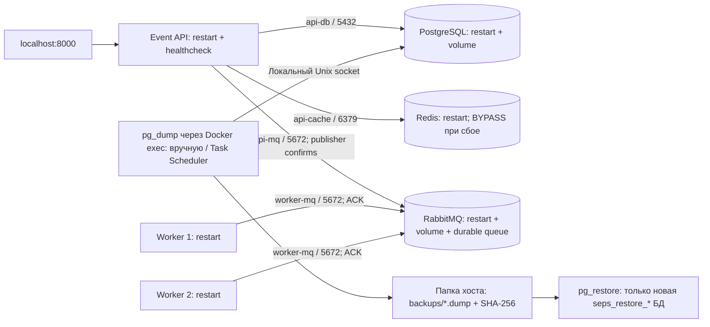

# ДЗ 5 — надёжность SEPS

В семинаре указано **CLI**, а в лекции рассматривается **SLI**. В этой работе используем SLI как рабочую трактовку расхождения. Это не подтверждённое преподавателем исправление формулировки.

База реализации — `homework-4-network-security`. Сохраняются API ДЗ 3, четыре сети, Default Deny, локальные firewall и ограничения опубликованных портов.

## Показатели: определения и цели

**Все значения в столбце «Цель» — учебные ориентиры, а не измеренные гарантии.** Фактические эксперименты описаны отдельно в [reliability-results.md](reliability-results.md). Один короткий эксперимент не подтверждает долгосрочный SLO.

| Показатель | Определение и расчёт | Цель / область применения |
|---|---|---|
| MTBF | Суммарное время исправной работы / число непреднамеренных отказов; учитывать конкретный сервис и период наблюдения | Ориентир ≥8 часов для каждого процесса API/Worker в локальной учебной сессии; длительное наблюдение ещё не проведено |
| MTTR | Суммарное время восстановления после отказов / число восстановленных отказов | ≤30 с для процесса API/Worker; отдельные эксперименты дают TTR, а не статистически устойчивый MTTR |
| SLI доступности HTTP | Число корректных ответов на валидные запросы / число таких запросов; ошибки соединения и 5xx — неуспех | SLO ≥99% на 10-минутном проверочном окне, включая отказы зависимостей; не доказан коротким тестом |
| SLI задержки GET | p95 длительности успешных валидных GET, ближайший ранг `ceil(0.95*N)`; ошибки учитывать отдельно | SLO p95 ≤500 мс при доступных зависимостях, локальном клиенте и небольшом объёме данных |
| SLI обработки сообщений | Доля ID из успешных POST 201, наблюдаемых в логах Worker за ≤5 с | SLO ≥99% при работающем брокере и хотя бы одном Worker; логи — тестовый индикатор, не долговременный аудит |
| RTO процесса | От аварии до успешного функционального запроса/получения нового сообщения | ≤30 с API и Worker |
| RTO зависимостей | От команды возвращения/перезапуска до функционального восстановления | Redis ≤15 с, PostgreSQL и RabbitMQ ≤60 с |
| RTO восстановления данных | От запуска restore до проверки таблицы и выбранного события в новой БД | ≤120 с для тестовой копии ≤1 MiB; не оценка восстановления большого production-кластера |
| RPO при перезапуске | Максимальный потерянный интервал данных при сохранном рабочем томе | 0 для уже зафиксированных строк PostgreSQL и подтверждённых persistent-сообщений в проверяемом сценарии рестарта |
| RPO из ежедневных копий | Возраст последнего корректного snapshot на момент утраты данных | Цель ≤24 ч только при успешном ежедневном расписании, доступной копии и контроле её свежести |
| RTO/RPO всего хоста | Восстановление после потери компьютера, диска или Docker VM | Не гарантируются этим стендом: нужен другой хост и внешняя копия |

При отсутствии отказов нельзя объявить MTBF бесконечным или равным выдуманному значению. Записываем длительность наблюдения и «недостаточно данных». Управляемые инъекции отказов не используются как частота естественных отказов. TTR разных механизмов не усредняем в одно число MTTR всей системы.

Для будущего измерения MTBF: вести журнал неожиданных выходов/restart count, отмечать плановые остановки и эксперименты, накапливать часы исправной работы отдельно по сервисам. Для SLI — регулярно посылать валидные запросы, сохранять статус/latency и ID опубликованных событий. Невалидные запросы клиента (например, ожидаемый 422) в этот SLO не входят. `/health` сам по себе не доказывает работоспособность записи/чтения.

## Архитектура и механизмы восстановления



| Компонент | Реализованный механизм | Реальная граница |
|---|---|---|
| API | `restart: unless-stopped`, healthcheck, повторная инициализация и новые соединения БД/брокера; Redis reconnect | Один экземпляр: при падении HTTP временно недоступен |
| Worker | Два активных consumer, `prefetch=1`, ручной ACK, reconnect; restart каждого процесса | Резервирование обработки, не брокера и не Docker-хоста |
| PostgreSQL | Restart, healthcheck, именованный том, `pg_dump`/`pg_restore` | Один сервер, без репликации/failover |
| Redis | Restart, healthcheck, fallback в PostgreSQL, повторное заполнение кэша | Кэш временный; его потеря допустима, память/данные БД не резервируются Redis |
| RabbitMQ | Restart, healthcheck, том, durable queue и persistent messages с confirms | Один узел: в период сбоя публикация недоступна |
| Docker/Windows/диск | Ручной запуск Docker Desktop и восстановление инфраструктуры | Общая единая точка отказа всех контейнеров |

Второй Worker называется `event-worker-standby`, но **оба активны**, без leader election: RabbitMQ распределяет сообщения между consumer. Он использует уже существующую `worker-mq`, IP `.13.4` и только TCP 5672. Это небольшой пример резервирования stateless-сервиса без добавления HTTP-балансировщика, frontend-сети и дополнительных связей с БД/Redis. API остаётся SPOF; два Worker не обеспечивают HA всей системы.

Restart — восстановление после простоя; это не высокая доступность. `unless-stopped` восстанавливает аварийно завершившийся контейнер, но не отменяет намеренный `docker compose stop`. Статус `unhealthy` не вызывает restart сам по себе. Если процесс завис, но жив, потребуется диагностика/ручной перезапуск; watchdog не добавлен.

### Настоящий crash вместо ручного stop

После применения firewall и снятия capabilities запускается непривилегированный `tini`, а под ним — Uvicorn или Worker. Tini пересылает сигналы, собирает завершившиеся дочерние процессы и выходит при падении основного процесса. Корневого процесса с NET_ADMIN после старта не остаётся.

`scripts/check_reliability.py` находит единственный дочерний PID Tini и посылает ему SIGKILL от UID 10001 через Docker exec. Docker не получает команды stop/kill контейнера, поэтому проверяется именно restart policy. Скрипт требует увеличения `RestartCount` при том же container ID. Перед инъекцией процесс работает не менее 10 с, чтобы пройти стартовое окно Docker. Локальные ошибки PostgreSQL/RabbitMQ не лечатся бесконечными повторными INSERT/POST: неоднозначный повтор может создавать дубликаты.

## Сохранение безопасности ДЗ 4

Новых сетей, опубликованных портов или сетевого backup-сервиса нет. Единственное новое межсервисное разрешение:

| Источник | Назначение | Результат |
|---|---|---|
| Worker 2 `.13.4` | RabbitMQ `.13.3`:5672 | ALLOW |
| Worker 2 | PostgreSQL, Redis, API:8000, Management:15672 | DENY |
| Worker 1 → Worker 2 и обратно | Новые соединения | DENY по INPUT/OUTPUT DROP; у Worker нет сервера |

Ранее разрешённые API→БД/Redis/AMQP и Worker 1→AMQP сохранены. Остальные запреты ДЗ 4 сохранены. Работают IPv4/IPv6 DROP-политики, NET_RAW снята, no-new-privileges включён, NET_ADMIN удаляется из capability sets до запуска сервисов. Для Tini и его потомков действует тот же UID 10001 и пустые capabilities. Backup работает через локальный socket PostgreSQL, используя доверенный Docker CLI владельца стенда; у него нет отдельного доступа в сеть.

`check_networks.py` проверяет 5 разрешённых направлений и 20 запрещённых TCP-соединений к слушающим портам, актуальные сети, capabilities PID 1 и DROP counters. Матрица README дополнена Worker 2. Доступ владельца Docker daemon остаётся административной границей доверия, как в ДЗ 4.

## Резервное копирование

| Параметр | Политика |
|---|---|
| Формат | Полный логический `pg_dump --format=custom --no-owner --no-acl` |
| Расписание | Пример: ежедневно в 02:00 по локальному времени Windows; если компьютер в часовом поясе Москвы — MSK |
| Хранение | Последние 7 успешных полных копий; при одном запуске в день — примерно 7 дней. Ручные запуски тоже участвуют в ротации |
| Путь | По умолчанию `backups/` на хосте, вне рабочего Docker Volume PostgreSQL; можно выбрать `--directory` вне репозитория |
| Проверка | Ненулевой размер, `pg_restore --list`, SHA-256 в JSON-манифесте; затем отдельная контрольная реставрация |
| Публикация файла | `.partial` → атомарное переименование; манифест появляется после успешного dump/проверки |
| Параллельность | Lock-каталог не даёт одновременно выполнять две backup/restore-задачи в одной папке |
| Ошибка | Ненулевой exit code; неполный файл удаляется, прежние копии не ротируются |
| Секреты | Пароли не передаются через аргументы хостового процесса; `.env`, backups и reports исключены из Git |

`pg_dump` делает согласованный MVCC snapshot, не выключая запись API. `started_at`/`completed_at` в манифесте ограничивают интервал создания копии; нельзя считать, что она включает все события вплоть до завершения команды. Восстановление проверяет копию на повреждение, а не её криптографическую подлинность: SHA-256 не защищает от злоумышленника, изменившего и архив, и манифест.

Папка хоста не совпадает с рабочим томом и переживает обычное пересоздание контейнеров. Но тот же физический диск/компьютер остаётся общей точкой отказа. Для реального RPO нужна внешняя/offsite-копия, контроль свежести, защита ACL и при необходимости шифрование. Не помещайте архивы в общедоступные папки. PostgreSQL dump не включает пароли/роли кластера, RabbitMQ, `.env` и конфигурацию Docker; их восстановление планируется отдельно.

### Создать и проверить копию — PowerShell

Из папки репозитория, при запущенном PostgreSQL и установленном Python:

```powershell
$copy = (py -3 -m scripts.backup create --directory backups --keep 7) | ConvertFrom-Json
$copy.archive
py -3 -m scripts.backup verify $copy.archive
```

Можно использовать `.\.venv\Scripts\python.exe` вместо `py -3`. Скрипт использует только стандартную библиотеку Python и установленные в контейнере PostgreSQL утилиты. Бинарный dump передаётся через Python file streams: **не используйте `>` PowerShell 5 для перенаправления `pg_dump`**, оно может изменить бинарные данные.

Проверка `--list` и checksum — необходимая предварительная проверка, но не замена тестовому восстановлению содержимого.

### Восстановить в новую тестовую БД

```powershell
$testDb = "seps_restore_" + (Get-Date -Format "yyyyMMddHHmmss")
py -3 -m scripts.backup restore $copy.archive --database $testDb
docker compose exec postgres psql -U seps -d $testDb -c "SELECT id, event_type, username FROM events ORDER BY created_at DESC LIMIT 5;"
```

При изменённых POSTGRES_USER/DB подставьте свой логин. Время команды restore и число строк печатаются/измеряются в fault-тесте; обычный restore выводит имя БД и count.

Защита процедуры:

- Имя должно иметь вид `seps_restore_*`, состоять из безопасных символов и отличаться от текущей рабочей БД.
- `createdb` откажется, если БД уже существует; `pg_restore` не будет вызван.
- Нет `DROP`, `--clean` и перезаписи рабочей БД. При ошибке восстановления новая БД остаётся для диагностики; неуспешный результат не выдаётся за готовую копию.
- Автотест сравнивает конкретное событие до dump и в новой БД; событие, созданное после dump, должно отсутствовать в восстановленной БД и оставаться в рабочей.

Для настоящей аварии сначала восстановите копию в новую БД и проверьте содержимое. Переключение приложения на восстановленную БД — отдельный ручной шаг с проверкой `.env`, credentials, схемы и актуальности данных; демонстрация его не выполняет. Производственные данные не удаляются.

После ручной проверки допускается отдельно удалить **только явно выбранную тестовую БД** через `dropdb`; скрипт её автоматически не удаляет. Если процесс backup был аварийно прерван и остался `.backup.lock`, сначала убедитесь, что другой backup/restore не работает, затем удалите только этот пустой lock-каталог. Не удаляйте архивы/тома для разблокировки.

### Автоматическое расписание в Windows

Создайте `.venv` по README и выполните:

```powershell
powershell.exe -NoProfile -ExecutionPolicy Bypass -File .\scripts\install_backup_task.ps1 -At "02:00"
Start-ScheduledTask -TaskName "SEPS-Daily-Backup"
Get-ScheduledTaskInfo -TaskName "SEPS-Daily-Backup"
```

ExecutionPolicy Bypass действует только для этого запуска PowerShell и не меняет системную политику. Скрипт создаёт ограниченную задачу текущего пользователя с рабочей папкой проекта и Python из `.venv`, без паролей в Task Scheduler. Существующую задачу с тем же именем не перезаписывает. Проверяйте `LastTaskResult=0` и появление свежей пары dump/json. Адрес и размер подтверждаются `verify`, актуальность данных — тестовым restore.

Задача выполняется при входе пользователя; Docker Desktop и PostgreSQL должны быть запущены. `StartWhenAvailable` не запускает Docker и не гарантирует копию пропущенного дня. Ограничения Task Scheduler/политики организации могут потребовать настройки через GUI или администратора. На Linux аналогичное расписание можно задать cron текущего пользователя с абсолютными путями к репозиторию и Python. Отдельный постоянно работающий cron-контейнер не нужен.

Для удаления **этой** задачи:

```powershell
Unregister-ScheduledTask -TaskName "SEPS-Daily-Backup" -Confirm
```

## Воспроизводимые эксперименты

Выполняйте на учебном стенде, когда все шесть контейнеров работают. Не запускайте одновременно с интеграционными/network-тестами: сценарий намеренно прерывает компоненты. Синтетические записи, копия и отдельная тестовая БД сохраняются для просмотра. Рабочие данные не очищаются.

```powershell
py -3 -m scripts.check_reliability --report reports/reliability.json
Get-Content -Raw -Encoding UTF8 reports/reliability.json
py -3 scripts/check_networks.py
```

Для Bash: `python3 -m scripts.check_reliability --report reports/reliability.json`. При другом порте API задайте `--base-url http://127.0.0.1:8001`.

| Эксперимент | Критерий восстановления и доступность во время сбоя |
|---|---|
| Crash API | Тот же container ID, больший RestartCount и корректный GET. Есть краткий HTTP-простой |
| Crash Worker 1 | На время этого теста второй Worker остановлен, чтобы проверить именно autorestart первого; новый ID появляется в его логах. API продолжает принимать сообщения |
| Резервирование Worker | Первый приостановлен SIGSTOP, второй логирует хотя бы одно из двух новых событий; prefetch=1 не позволяет приостановленный consumer забрать оба. После SIGCONT обработаны оба ID |
| Redis | При stop GET=200/BYPASS, POST=201; после start наблюдается HIT. Функциональная доступность сохраняется |
| PostgreSQL | При пустом кэше и stop GET=503, `/health`=200; после start событие и точное содержимое сохранены |
| RabbitMQ | Оба Worker приостановлены SIGSTOP, POST=201 подтверждает публикацию; после restart брокера сообщение остаётся в очереди и затем логируется по тому же ID после SIGCONT/reconnect. Оба consumer снова подключены |
| Backup/restore | Копия проверена, отдельная БД содержит исходный marker; более позднее событие есть только в production. Источник не перезаписан |

SIGSTOP/SIGCONT посылаются только дочерним процессам Worker внутри контейнера: тест не требует поддержки cgroup freezer/Docker pause и работает также в rootless-окружении.

Время измеряется `time.monotonic`: от отправки команды аварии/возвращения компонента до первого наблюдаемого функционального успеха. Оно включает задержки Docker CLI, проверки и интервал опроса 0.25 с; не является точной внутренней длительностью рестарта. Для consumer отсчёт начинается с SIGCONT после возвращения брокера, это явно отдельная величина. До/после ручного stop время не обозначается автоматическим failover.

В отчёте отдельно сохраняются цели, TTR, соответствие цели, HTTP samples и их SLI. Короткое окно около инъекции содержит намеренный сбой: его доступность не экстраполируется на 10 минут или месяц. Для сервисов без сбоя HTTP не объявляется 100%-м долгосрочным показателем по двум запросам.

## Что не гарантируется

Нет PostgreSQL/RabbitMQ-кластеров, автоматического failover хоста, HTTP-балансировки и внешнего хранилища копий. Последовательные PostgreSQL commit и публикация всё ещё не атомарны: outbox/идемпотентность не добавлены. POST 503 с сохранённым ID может оставить строку без сообщения; потеря подтверждения и повторный POST могут дать дубликаты. ACK после логирования допускает повторную запись в лог при сбое между log и ACK. Проверка сохранности persistent-сообщения относится к конкретному рестарту с исправным томом, а не к потере диска.

Windows Task Scheduler и конкретная машина пользователя здесь не исполняются. Облачные тесты Linux Docker подтверждают работу Linux-процессов, netfilter и процедур, но расписание и RTO нужно повторить на своей Windows 11/WSL 2. Никакие тесты не меняют глобальные правила Firewall Windows или Docker-хоста.
